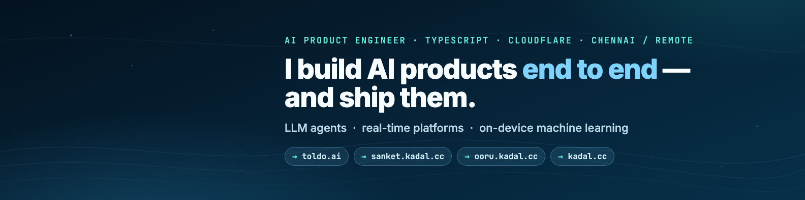
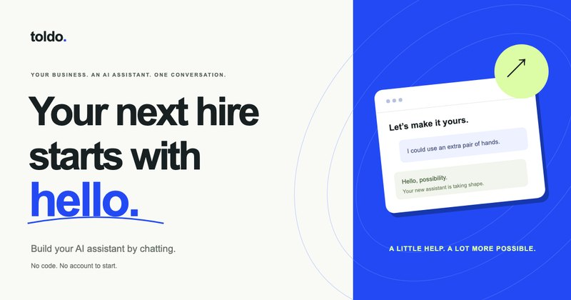
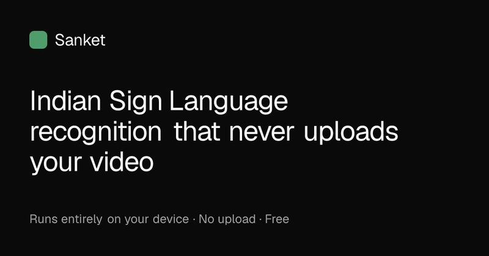
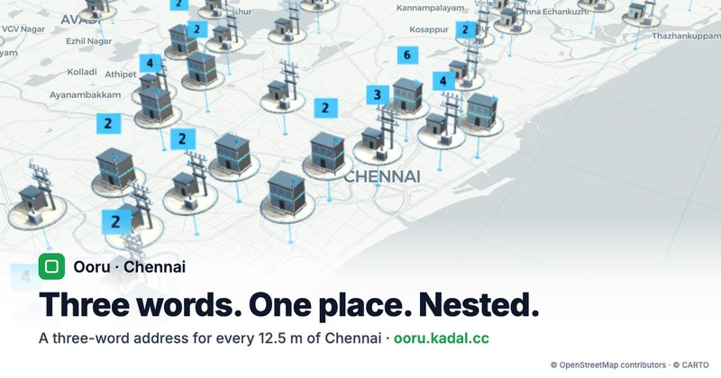
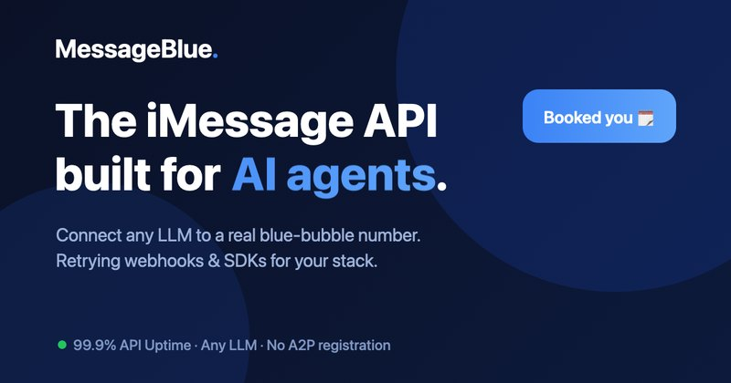
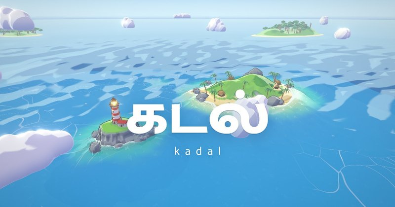
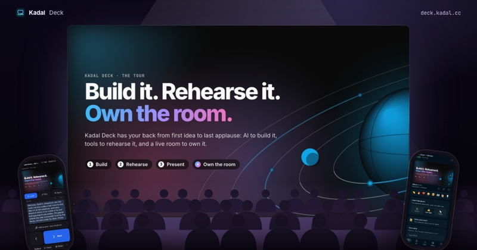
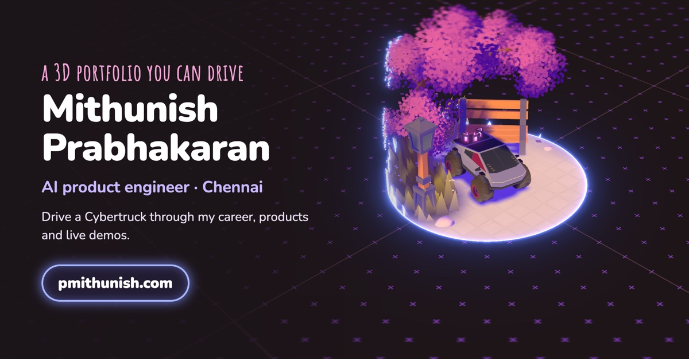

### Hi, I'm Mithunish 👋

I build AI products end to end: the agent, the platform under it, the UI on top. Then I ship them to production.

- **Now:** Senior Software Engineer at Qualkode Technologies, building production AI agents for Blush (VIP matchmaking), the agent layer of [MessageBlue](https://messageblue.ai), and leading engineering on [Toldo](https://toldo.ai).
- **Studying:** M.Tech in Artificial Intelligence at SRM (2025–27).
- **Before:** 8 years across product companies and consulting, including leading a team of 8 building products for US clients.
- **Looking for:** AI product engineering or senior full-stack roles, in Chennai or remote.
- **Portfolio:** [pmithunish.com](https://pmithunish.com), a small 3D world you drive through.

### Things I've built, live

<table>
  <tr>
    <td width="50%" valign="top">
      
       <b><a href="https://toldo.ai">Toldo</a></b>: describe the assistant your business needs; Toldo builds it and publishes it to your website, Slack, Telegram or Teams.
       Cloudflare Workers · Durable Objects (Agents SDK) · D1 · React · Stripe
    </td>
    <td width="50%" valign="top">
      
       <b><a href="https://sanket.kadal.cc">Sanket</a></b>: Indian Sign Language recognition that runs fully offline in the browser. A 4.6 MB model at 12.5 ms per window over an 8,165-word vocabulary.
       MediaPipe · PyTorch · self-supervised JEPA · int8 ONNX · Web Workers
    </td>
  </tr>
  <tr>
    <td width="50%" valign="top">
      
       <b><a href="https://ooru.kadal.cc">Ooru</a></b>: a three-word address for every 12.5 m of Chennai, plus a <a href="https://ooru.kadal.cc/outages">citizen power-cut map</a> that resists abuse without logins.
       Next.js on Cloudflare Workers · D1 · deck.gl · MapLibre · Turnstile
    </td>
    <td width="50%" valign="top">
      
       <b><a href="https://messageblue.ai">MessageBlue</a></b> (agent layer): per-app RAG, memory, voice-note replies, and MCP tool integrations behind confirmation gates.
       TypeScript · MongoDB Atlas Vector Search · OpenRouter · Slack &amp; Teams
    </td>
  </tr>
  <tr>
    <td width="50%" valign="top">
      
       <b><a href="https://kadal.cc">kadal.cc</a></b>: a scroll-dive through a toon sea that links my apps. 54 procedurally generated Blender assets in ~1.3 MB.
       three.js · TypeScript · Blender CLI
    </td>
    <td width="50%" valign="top">
      
       <b><a href="https://deck.kadal.cc">Kadal Deck</a></b>: Build it. Rehearse it. Own the room. My studio's first product, launched on Product Hunt on 27 Oct 2026: an AI assistant drafts the deck with you, narration and a teleprompter help you rehearse, your phone is the remote, and the audience joins a live room from their phones.
       MDX · React · MCP · Durable Objects with hibernating WebSockets · open source (AGPL)
    </td>
  </tr>
</table>

And in production for Blush: AI agents that chat with clients, coordinate dates and book calls, plus the CRM behind them. One fix took a booking query from 2.18M documents examined to 1,684.

Most of my code lives in private repositories (employer and coursework), which is why the repo list here is short. I'm happy to walk through any of it.

### How I work

AI-native: I run coding agents in parallel behind hard verification gates (typecheck, tests, real-browser checks), so I ship at the pace of a small team without lowering the bar.

### Stack

TypeScript · React · Node / Bun · Hono · Effect · PostgreSQL · Redis · Cloudflare (Workers, D1, Durable Objects, R2) · LLM APIs, agents & evals · PyTorch · ONNX · Python · Rust

### Find me

<table>
  <tr>
    <td width="50%" valign="top">
      
       <b><a href="https://pmithunish.com">pmithunish.com</a></b>: my portfolio as a small 3D world. Drive a Cybertruck through my career, products and live demos, and leave a whisper for the next visitor.
       three.js (WebGPU) · TypeScript · Durable Objects · Workers AI moderation · built on Bruno Simon's open-source folio-2025
    </td>
    <td width="50%" valign="top">
      <b>Work</b>
       <a href="https://www.linkedin.com/in/pmithunish/">LinkedIn</a> · <a href="mailto:pmithunish@gmail.com">pmithunish@gmail.com</a> · <a href="https://kadal.cc">Kadal</a>, my studio
        <b>Social</b>
       <a href="https://x.com/pmithunish">X</a> · <a href="https://bsky.app/profile/pmithunish.com">Bluesky</a> · <a href="https://mastodon.social/@pmithunish">Mastodon</a> · <a href="https://www.threads.com/@pmithunish">Threads</a> · <a href="https://www.instagram.com/pmithunish/">Instagram</a> · <a href="https://www.youtube.com/@pmithunish">YouTube</a>
        <b>Writing and community</b>
       <a href="https://dev.to/pmithunish">DEV</a> · <a href="https://news.ycombinator.com/user?id=pmithunish">Hacker News</a> · <a href="https://www.reddit.com/user/pmithunish/">Reddit</a> · <a href="https://app.daily.dev/pmithunish">daily.dev</a>
        <b>Launches</b>
       <a href="https://www.producthunt.com/@pmithunish">Product Hunt</a> · <a href="https://www.indiehackers.com/pmithunish">Indie Hackers</a> · <a href="https://peerlist.io/pmithunish">Peerlist</a>
    </td>
  </tr>
</table>
